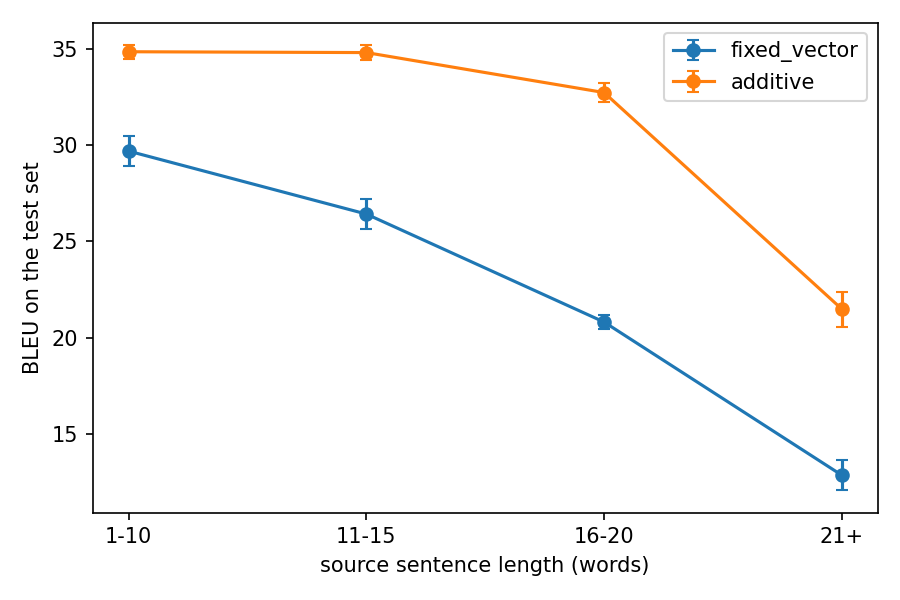
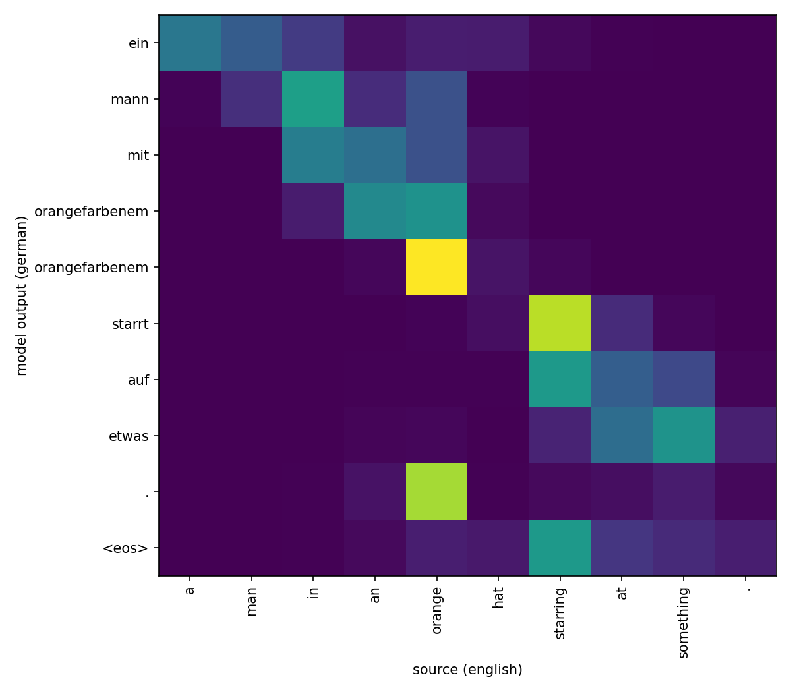
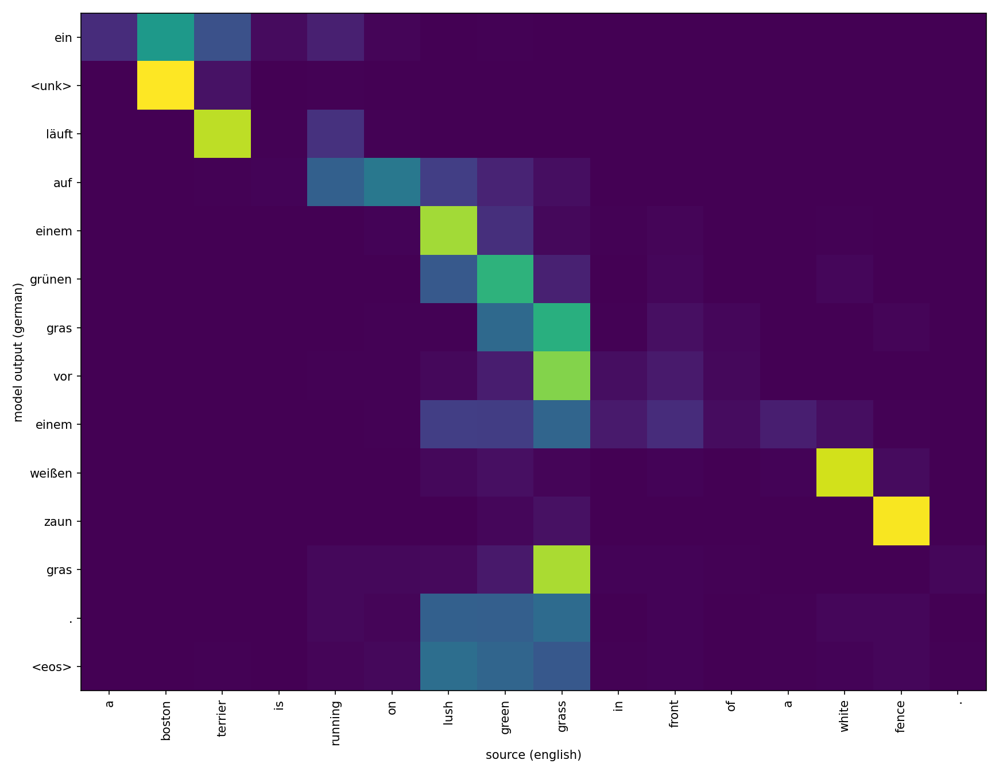
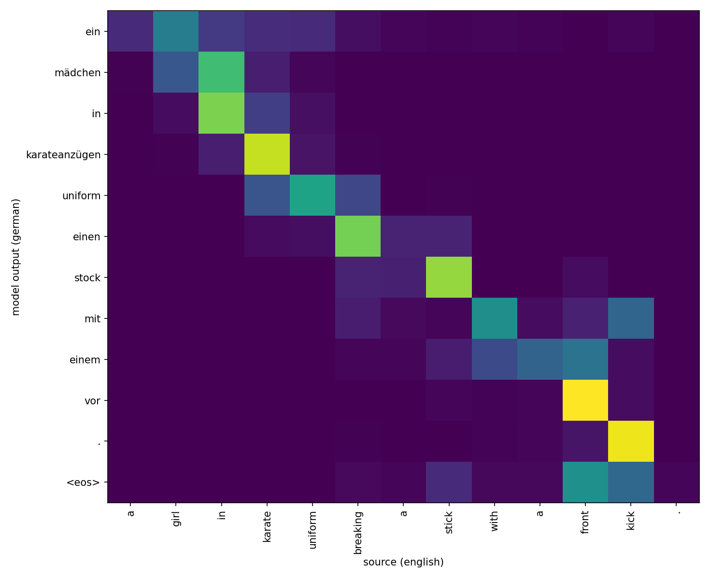

# Bahdanau-Attention-from-scratch

A small PyTorch re-implementation of [Neural Machine Translation by Jointly Learning to Align and Translate](https://arxiv.org/abs/1409.0473) (2014) paper, built to see myself that how attention is better than compressing a whole sentence into one vector.

"From scratch" means, I wrote the whole encoder, additive (attention) layer and the decoder myself. I use PyTorch's basic pieces (GRU, Embeddings, Linear Layers) and no seq2seq library.

**Result in one line:** on the Multi30k test set, attention reached about 33.0 BLEU against 24.4 for the fixed vector (mean of 3 seeds). Details below.

## The paper in short 

Paper: Bahdanau, Cho and Bengio, [Neural Machine Translation by Jointly Learning to Align and Translate](https://arxiv.org/abs/1409.0473) (2014). arXiv 1409.0473.

### The problem before this paper

Translation models had two parts, one is encoder which read the sentence and compressed a whole sentence into one fixed length vector and a decoder wrote the translation using that encoder vector.

That is a huge bottleneck. The vector is the same size for a 5 words sentence or a 50 words sentence, so a long sentence has to be compressed into same small space. The decoder cannot go back and look at one particular source word while it writes.

In this type of models, the performance deteriorates rapidly as the length of an input sentence increases. [[2]](#ref2)

### What it solves

- The single-vector bottleneck is gone, because the decoder can use any source word at any step.
- Different output words can look at different source words, which helps when the word order differs between the two languages.
- The weights show what the model looked at for each output word, so the alignments can be plotted and checked by eye. The paper says the learned alignments matched intuition.
- On English to French, the paper reports translation quality comparable to the phrase-based systems of that time.

### What the paper does

- The encoder keeps one vector for every source word, and it reads in both directions, so each word's vector knows about the words before and after it.
- At every output step, the decoder scores all the source words by how useful each one is for the word it is about to write.
- The scores are turned into weights that add up to 1, and the decoder takes a weighted mix of the source vectors as its context for that step.
- The search is "soft", so nothing is a hard yes or no, and the whole model trains normally with backpropagation.

### What this repo does

This repo does not try to reproduce the paper's English to French results. It re-implements the idea from scratch and compares attention against the plain fixed-vector model on a small dataset (Multi30k, English to German).

## Data

Multi30k [[5]](#references), English to German. It is a set of short image captions with their German translations. I use the text-only version (`bentrevett/multi30k`), so there are no images.

- 29,000 training pairs
- 1,014 validation pairs (for tuning and early stopping)
- 1,000 test pairs (used once at the end)


## The two models

Both use the same bidirectional GRU encoder, the same sizes and the same decoder start state. Only the context given to the decoder is different.

- `fixed_vector`: the decoder gets the same summary vector at every step.
- `additive`: at every step the decoder scores all source words, turns the scores into weights, and takes a weighted mix of the words (Bahdanau attention) [[1]](#references).

### How the additive layer works

"Additive" is the way the score is made: the decoder state and each source word vector are projected, added together, passed through tanh, and turned into one number. There are three steps, and they are the three formulas of the paper ([arXiv:1409.0473](https://arxiv.org/abs/1409.0473)).

**1. Score.** How useful is source word `j` for the word I am about to write (output step `i`)?

$$
e_{ij} = v_a^{\top} \tanh\left(W_a \, s_{i-1} + U_a \, h_j\right)
$$

**2. Weights.** Turn the scores into weights that add up to 1.

$$
\alpha_{ij} = \frac{\exp(e_{ij})}{\sum_{k=1}^{T_x} \exp(e_{ik})}
$$

**3. Context.** Take the weighted mix of the source word vectors.

$$
c_i = \sum_{j=1}^{T_x} \alpha_{ij} \, h_j
$$

What the letters mean:

- `s_{i-1}`: the decoder's previous hidden state
- `h_j`: the encoder vector for source word `j` (forward and backward states joined)
- `W_a`, `U_a`, `v_a`: weights the model learns, trained together with everything else
- `T_x`: the number of words in the source sentence

In the code, these are in [`src/layers/additive.py`](https://github.com/mohithxkarthikeya/Bahdanau-Attention-from-scratch/blob/main/src/layers/additive.py): step 1 is the `tanh(...) @ v` line, step 2 is the softmax, and step 3 is the `bmm`. One thing the paper doesn't cover: the padding positions get a score of minus infinity before the softmax, so they end up with weight 0.

## How to run

Run everything from the repo root.

```
git clone https://github.com/mohithxkarthikeya/Bahdanau-Attention-from-scratch.git
cd Bahdanau-Attention-from-scratch
pip install -r requirements.txt
python -m pytest
python -m src.train --attention fixed_vector --seed 0
python -m src.train --attention additive --seed 0
python -m src.evaluate --attention fixed_vector --seed 0
python -m src.evaluate --attention additive --seed 0
python -m src.plots
```

Repeat the train and evaluate commands with `--seed 1` and `--seed 2` to get 3 seeds per model. A GPU helps a lot, because the decoder runs one word at a time.

## Files

- `src/data.py`: loads Multi30k, builds the vocabularies, makes batches
- `src/layers/encoder.py`: the bidirectional GRU encoder
- `src/layers/fixed_vector.py`: the plain model (same vector every step)
- `src/layers/additive.py`: Bahdanau attention
- `src/models.py`: the seq2seq model that uses one of the two layers
- `src/train.py`: training with early stopping on validation loss
- `src/evaluate.py`: test loss, BLEU, and BLEU by sentence length
- `src/plots.py`: BLEU vs length plot and attention heatmaps
- `tests/`: shape and mask checks for the encoder and the two layers

## Results

Three seeds per model, English to German, tested on the 1,000 Multi30k test sentences. Both models were trained with early stopping on the validation loss. The test set was used once at the end.

| Model | Test BLEU (mean) | Test BLEU (seed 0, 1, 2) | Test loss | Test perplexity |
|---|---|---|---|---|
| fixed_vector | 24.42 | 23.81, 24.42, 25.04 | 2.03 to 2.05 | 7.6 to 7.8 |
| additive | 33.02 | 33.14, 33.08, 32.83 | 1.66 to 1.67 | 5.3 |

BLEU by source sentence length (mean of 3 seeds):

| Source length | Sentences | fixed_vector | additive | Difference |
|---|---|---|---|---|
| 1 to 10 words | 283 | 29.68 | 34.84 | +5.16 |
| 11 to 15 words | 494 | 26.41 | 34.80 | +8.39 |
| 16 to 20 words | 167 | 20.80 | 32.72 | +11.92 |
| 21 or more words | 56 | 12.85 | 21.48 | +8.63 |



The dots are the mean of the 3 seeds, and the bars show how much the seeds differ (standard deviation).

## What I found

- Attention was better in every run. Mean test BLEU was 33.0 for additive and 24.4 for fixed_vector, about 8.6 higher. The seed results do not overlap (the best fixed_vector run got 25.04, the worst additive run got 32.83).
- The fixed vector gets worse faster as sentences get longer. From the shortest group to the longest, fixed_vector loses about 17 BLEU (29.7 to 12.8) and additive loses about 13 (34.8 to 21.5). From 11-15 words to 16-20 words, fixed_vector drops 5.6 points and additive only 2.1.
- The gap is not only about long sentences. Additive is already about 5 BLEU ahead on sentences of up to 10 words. I did not test why, so I can't say the bottleneck is the whole reason.
- The gap is biggest at 16-20 words and smaller at 21 or more words. The 21+ group has only 56 sentences, so I would not read much into that.
- Both models still make mistakes. Some outputs contain `<unk>`, some repeat phrases, and some write things that are not in the source sentence.
- Attention heatmaps (additive model, seed 0, first three test sentences): the attention mostly moves left to right through the English sentence as the German is written, and it usually lands on the matching word (for example "starring" for *starrt*, "white" for *weißen*, "fence" for *zaun*). Sometimes it looks at the word right after the matching one. The heatmaps also show mistakes: in the first sentence "hat" gets almost no attention and *orangefarbenem* is written twice, and in the second sentence the attention goes back to "grass" at the end and *gras* is repeated. The attention weights show where the model looked, which is not a full explanation of why it wrote a word.





What I am not sure about:

- This is one dataset, one model size, one training setup and greedy decoding, so I can't say the same gap holds elsewhere.
- Three seeds is enough to see the difference here, but too few for exact error bars.

## Setup and limits

- Encoder: 1-layer bidirectional GRU. Embedding size 256, hidden size 256, dropout 0.3.
- Training: Adam, learning rate 0.001, batch size 128, gradient clipping at 1.0, up to 15 epochs, stopping when the validation loss does not improve for 3 epochs.
- Decoding: greedy (always the most likely next word). No beam search.
- Vocabulary: only words seen at least twice in the training set are kept (5,898 English and 7,882 German entries, counting special tokens). Every other word becomes `<unk>`, which hurts both models.
- Size and speed: fixed_vector has 13.32M parameters and additive has 13.51M. The extra 197K are the attention layer. On a Kaggle T4 an epoch took about 24 seconds for fixed_vector and about 33 for additive.
- Hardware: a Kaggle GPU (T4 x2). The 6 trainings, the evaluations and the plots took about 39 minutes in total.
- The `U` projection in the attention layer has a bias, the paper's does not. This is a small difference.
- BLEU is computed on lowercased, word-split text, so it is not comparable with numbers from papers. Only compare the two models with each other.
- Small groups give noisy scores. The "21 or more words" group has only 56 sentences.
- The test set was never used for tuning or for choosing when to stop.


## Outputs

After running, these folders appear:

- `checkpoints/`: saved models (these are not uploaded to GitHub)
- `results/`: CSV files with the training runs, test scores and BLEU by length
- `plots/`: the BLEU vs length plot and the attention heatmaps

## License

MIT, see [LICENSE](LICENSE).

## Credits

See [CREDITS.md](CREDITS.md).

## References

1. D. Bahdanau, K. Cho, Y. Bengio. [*Neural Machine Translation by Jointly Learning to Align and Translate.* 2014 (ICLR 2015).](https://arxiv.org/abs/1409.0473)
   The paper this repo re-implements: bidirectional encoder and additive attention.

2. <a id="ref2"></a>K. Cho, B. van Merrienboer, D. Bahdanau, Y. Bengio. [*On the Properties of Neural Machine Translation: Encoder-Decoder Approaches.* 2014.](https://arxiv.org/abs/1409.1259)
   Earlier work on the plain fixed-vector encoder-decoder, including how it behaves on longer sentences.

3. K. Cho, B. van Merrienboer, C. Gulcehre, D. Bahdanau, F. Bougares, H. Schwenk, Y. Bengio. [*Learning Phrase Representations using RNN Encoder-Decoder for Statistical Machine Translation.* 2014.](https://arxiv.org/abs/1406.1078)
   Introduced the GRU, which the encoder and decoder use here.

4. I. Sutskever, O. Vinyals, Q. V. Le. [*Sequence to Sequence Learning with Neural Networks.* 2014.](https://arxiv.org/abs/1409.3215)
   The encoder-decoder idea that the fixed-vector baseline follows.

5. D. Elliott, S. Frank, K. Sima'an, L. Specia. [*Multi30K: Multilingual English-German Image Descriptions.* 2016.](https://arxiv.org/abs/1605.00459)
   The dataset. This repo uses only the text, from the Hugging Face copy `bentrevett/multi30k`.

6. P. Young, A. Lai, M. Hodosh, J. Hockenmaier. [*From image descriptions to visual denotations.* TACL, 2014.](https://aclanthology.org/Q14-1006/)
   Flickr30k, the image collection whose captions Multi30k is built on.

7. K. Papineni, S. Roukos, T. Ward, W.-J. Zhu. [*BLEU: a Method for Automatic Evaluation of Machine Translation.* ACL, 2002.](https://aclanthology.org/P02-1040/)
   The BLEU score used in evaluation.

8. M. Post. [*A Call for Clarity in Reporting BLEU Scores.* 2018.](https://arxiv.org/abs/1804.08771)
   The `sacrebleu` library used to compute BLEU.

9. A. Paszke et al. [*PyTorch: An Imperative Style, High-Performance Deep Learning Library.* 2019.](https://arxiv.org/abs/1912.01703) The framework everything is written in.